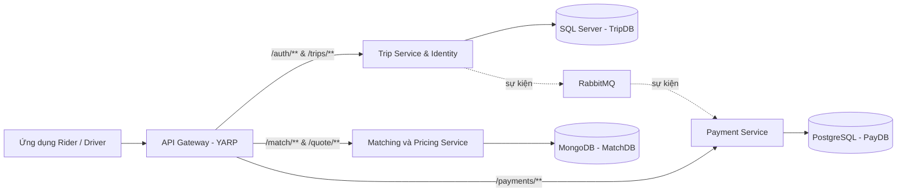

# SwiftRide - Môi trường phát triển & Kiến trúc hệ thống

Dự án này là hệ thống đặt xe microservices **SwiftRide** được mô tả trong [tài liệu kiến trúc](RideLite-KienTrucPhanMem.pdf). Solution `SwiftRide.sln` tuân thủ nguyên tắc tối đa 3 microservices cốt lõi, cùng API Gateway, thư viện dùng chung (`SwiftRide.Security`, `SwiftRide.Contracts`) và hạ tầng Docker đầy đủ.

---

## 📚 Tài Liệu Hướng Dẫn Kỹ Thuật (Documentation)

Dành cho các thành viên phát triển hệ thống:

- [**Luồng xử lý API & Tích hợp Microservices**](docs/api-flow.md): Sơ đồ luồng request từ Gateway vào Service, bảng route YARP, rate limiting, bảo vệ endpoint theo Dynamic Permissions (`.RequirePermission(...)`).
- [**Hướng dẫn Xác thực & Phân quyền động (Auth & Dynamic RBAC Guide)**](docs/auth-rbac.md): Chi tiết mô hình 5 bảng RBAC trong SQL Server `TripDB`, cơ chế JWT Bearer, bảng danh mục quyền, tài khoản test và API quản trị vai trò/quyền hạn.
- [**Hướng dẫn Quan sát hệ thống (OpenTelemetry Guide)**](docs/telemetry.md): Distributed Tracing, header `X-Correlation-ID`, truyền `traceparent` qua YARP/HttpClient, và cách xem span trong OTel Collector.
- [**Hướng dẫn Tích hợp Đăng nhập/Đăng ký cho Frontend**](docs/frontend-auth.md): Gọi REST API đăng nhập/đăng ký trực tiếp qua Gateway, lưu trữ token, phân quyền giao diện theo claims `permissions`.

---

## Kiến trúc hệ thống



Các service giao tiếp đồng bộ qua REST (thông qua Gateway) và bất đồng bộ qua RabbitMQ/MassTransit cho các sự kiện nghiệp vụ (`TripAccepted`, `RideCompleted`, `PaymentSettled`...).

## Công nghệ đã chuẩn bị

| Thành phần trong tài liệu | Trong môi trường này |
| --- | --- |
| .NET 10, C#, ASP.NET Core Minimal API | .NET 10 SDK, ASP.NET Core runtime và CLI |
| EF Core 10 | `Microsoft.EntityFrameworkCore.SqlServer` (Trip & Identity) và `Npgsql.EntityFrameworkCore.PostgreSQL` (Payment) |
| SQL Server, MongoDB, PostgreSQL | Ba container database riêng biệt (Polyglot Persistence) |
| YARP | Reverse Proxy định tuyến tại API Gateway, tích hợp Rate Limiter và CORS |
| RabbitMQ / MassTransit | Broker quản lý sự kiện phân tán |
| Xác thực & Dynamic RBAC | JWT Bearer (HMAC-SHA256), băm mật khẩu PBKDF2, quản lý Users/Roles/Permissions trong SQL Server `TripDB` |
| Bảo mật dùng chung (`SwiftRide.Security`) | JWT Bearer validation, `PermissionAuthorizationHandler`, extension `.RequirePermission(...)` |
| Giám sát phân tán (`OpenTelemetry`) | OTLP Collector nhận traces/metrics, middleware gắn `X-Correlation-ID` |
| Docker Compose | `.devcontainer/compose.yaml` quản lý toàn bộ stack hạ tầng |

---

## Kết nối hạ tầng & Cổng dịch vụ

| Dịch vụ | Tên host trong container | Cổng máy host | Tài khoản / Ghi chú |
| --- | --- | --- | --- |
| **API Gateway** | `gateway:5000` | `127.0.0.1:5000` | Điểm vào duy nhất cho client |
| **Trip Service & Auth** | `trip-service:8080` | `127.0.0.1:5001` | Quản lý vòng đời chuyến đi, User và Dynamic RBAC |
| **Matching Service** | `matching-service:8080` | `127.0.0.1:5002` | Báo giá và tìm tài xế |
| **Payment Service** | `payment-service:8080` | `127.0.0.1:5003` | Thanh toán và sổ cái |
| **SQL Server (TripDB)** | `sqlserver:1433` | `127.0.0.1:1433` | User: `sa` |
| **MongoDB (MatchDB)** | `mongodb:27017` | `127.0.0.1:27017` | User: `swiftdev` |
| **PostgreSQL (PayDB)** | `postgres:5432` | `127.0.0.1:5432` | User: `swiftdev`, DB: `PayDB` |
| **RabbitMQ Management** | `rabbitmq:15672` | [http://localhost:15672](http://localhost:15672) | User: `swiftdev` |
| **OTel Collector (gRPC/HTTP)** | `otel-collector:4317/4318` | `127.0.0.1:4317/4318` | Nhận OTLP spans & metrics |

*Mật khẩu cơ sở dữ liệu và RabbitMQ được cấu hình trong `.devcontainer/.env`.*

### Tài khoản người dùng mẫu có sẵn trong SQL Server

- **Rider**: `test-rider` / `Rider@123` (Role: `Rider`) - Đăng nhập qua `POST /auth/login`.
- **Driver**: `test-driver` / `Driver@123` (Role: `Driver`) - Đăng nhập qua `POST /auth/login`.
- **Admin**: `admin` / `Admin@123` (Role: `Admin`) - Đăng nhập qua cổng riêng `POST /admin/auth/login` (toàn quyền quản trị RBAC, tài khoản và giám sát vận hành).
- Người dùng đăng ký mới qua `POST /auth/register` sẽ tự động nhận role `Rider`.

---

## Bắt đầu phát triển

1. Chạy hạ tầng bằng Docker Compose:
   ```bash
   docker compose -f .devcontainer/compose.yaml up -d
   ```
2. Build toàn bộ Solution:
   ```bash
   dotnet build SwiftRide.sln
   ```
3. Chạy API Gateway:
   ```bash
   dotnet run --project src/ApiGateway --urls http://0.0.0.0:5000
   ```
4. Chạy các microservice tương ứng (mỗi service có cấu trúc Clean Architecture: `Domain`, `Application`, `Infrastructure`, `Api`):
   - Trip Service & Auth: `dotnet run --project src/TripService --urls http://0.0.0.0:5001`
   - Matching Service: `dotnet run --project src/MatchingService --urls http://0.0.0.0:5002`
   - Payment Service: `dotnet run --project src/PaymentService --urls http://0.0.0.0:5003`
