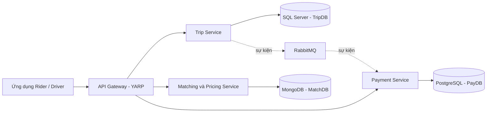

# SwiftRide - môi trường phát triển

Thư mục này hiện là bản khởi tạo môi trường cho hệ thống đặt xe **SwiftRide** mô tả trong [tài liệu kiến trúc](RideLite-KienTrucPhanMem.pdf). Tên thư mục là `rite-lite`, còn tài liệu gọi hệ thống là SwiftRide. Chưa có solution, mã nguồn API, ứng dụng Rider/Driver hay bài kiểm thử; các container hiện chỉ cung cấp công cụ và hạ tầng để bắt đầu phát triển.

## Kiến trúc dự kiến



Các service dự kiến dùng REST hoặc gRPC cho lời gọi đồng bộ và RabbitMQ/MassTransit cho sự kiện. Quy tắc nghiệp vụ, state machine, Outbox, Saga và xử lý idempotent sẽ được triển khai trong mã nguồn ở các bước sau.

## Công nghệ đã chuẩn bị

| Thành phần trong tài liệu | Trong môi trường này |
| --- | --- |
| .NET 10, C#, ASP.NET Core Minimal API/Controllers | Container làm việc dùng .NET 10 SDK, có sẵn ASP.NET Core runtime và CLI |
| EF Core 10 | Cài `dotnet-ef` 10.0.0; thêm gói `Microsoft.EntityFrameworkCore.SqlServer` và `Npgsql.EntityFrameworkCore.PostgreSQL` bản 10.x vào project tương ứng khi tạo mã nguồn |
| SQL Server, MongoDB, PostgreSQL | Ba container riêng, lưu dữ liệu bằng Docker volume; MongoDB dùng gói `MongoDB.Driver` trong Matching Service |
| YARP | Thêm gói `Yarp.ReverseProxy` vào API Gateway khi tạo project |
| RabbitMQ/MassTransit | Container RabbitMQ có giao diện quản trị; thêm `MassTransit.RabbitMQ` vào service cần gửi/nhận sự kiện |
| REST/gRPC | ASP.NET Core SDK và `protoc` có sẵn; thêm gói gRPC của .NET vào project cần dùng |
| OAuth 2.0/OpenID Connect, JWT Bearer | Thêm gói xác thực ASP.NET Core và cấu hình issuer/audience khi chọn nhà cung cấp danh tính |
| xUnit, Moq | Thêm vào các test project khi tạo bài kiểm thử |
| OpenTelemetry | Collector nhận OTLP gRPC/HTTP và in dữ liệu ra log; thêm các gói OpenTelemetry SDK/exporter vào ứng dụng khi triển khai instrumentation |
| Docker Compose | `.devcontainer/compose.yaml` khởi chạy môi trường; Dev Container có Docker CLI/Compose để xem các container trên host; terminal dùng Fish và Starship |

Các thư viện ứng dụng là **phụ thuộc NuGet của từng project**, nên chưa thể khai báo vào một project không tồn tại. Tài liệu không chỉ định framework cho Rider/Driver app hoặc identity provider, nên môi trường này chưa chọn thay bạn. Collector là đích nhận telemetry phục vụ phát triển, chưa có dashboard.

## Bắt đầu

1. Cài Docker Engine hoặc Docker Desktop có Compose, VS Code và extension **Dev Containers**. Máy cần đủ RAM cho SQL Server cùng ba dịch vụ dữ liệu khác. Image SQL Server Linux của Microsoft chỉ được hỗ trợ trên host x86-64; máy ARM có thể không chạy được toàn bộ stack này.
2. Khi dùng bản sao mới của thư mục, tạo `.devcontainer/.env` từ `.devcontainer/.env.example`, rồi đặt bốn mật khẩu riêng. Mật khẩu SQL Server cần từ 8 ký tự và ít nhất 3 nhóm trong chữ hoa, chữ thường, chữ số, ký hiệu. File `.env` được bỏ qua bởi Git. Trong workspace hiện tại, file này đã được tạo với mật khẩu ngẫu nhiên cho môi trường local.
3. Mở thư mục bằng VS Code, chạy **Dev Containers: Reopen in Container**. Nếu bạn đã mở Dev Container trước khi Docker CLI được thêm vào cấu hình, chạy **Dev Containers: Rebuild Container**. Lần đầu Docker sẽ tải image và build container làm việc. Terminal mặc định là Fish với Starship.
4. Trong terminal của devcontainer, kiểm tra công cụ:

   ```sh
   dotnet --info
   dotnet ef --version
   fish --version
   starship --version
   protoc --version
   docker version
   docker compose version
   docker compose -f .devcontainer/compose.yaml ps
   ```

Docker trong Dev Container dùng [Docker Outside of Docker](https://github.com/devcontainers/features/blob/main/src/docker-outside-of-docker/README.md): CLI bên trong kết nối tới Docker daemon trên host qua socket. Các database là những container **cùng Compose project**, không phải tiến trình chạy bên trong container làm việc. Quyền truy cập socket cho phép quản lý container trên host, nên chỉ bật cấu hình này trên máy phát triển tin cậy.

Có thể chạy môi trường bằng Compose mà không dùng VS Code:

```sh
docker compose -f .devcontainer/compose.yaml up -d --build
docker compose -f .devcontainer/compose.yaml exec workspace fish
```

Các lệnh Compose trên chạy từ thư mục gốc, trên host hoặc trong terminal của Dev Container sau khi rebuild. Khi chạy bên trong Dev Container, biến `LOCAL_WORKSPACE_FOLDER` giúp Compose dùng đúng đường dẫn bind mount trên host. Khi dừng, dùng `docker compose -f .devcontainer/compose.yaml down`; dữ liệu trong Docker volumes vẫn được giữ lại. Đóng Dev Container sẽ dừng Compose stack theo `shutdownAction: stopCompose`.

## Kết nối hạ tầng

| Dịch vụ | Tên host và cổng từ devcontainer | Cổng từ máy host |
| --- | --- | --- |
| SQL Server / TripDB | `sqlserver:1433` | `127.0.0.1:1433` |
| MongoDB / MatchDB | `mongodb:27017` | `127.0.0.1:27017` |
| PostgreSQL / PayDB | `postgres:5432` | `127.0.0.1:5432` |
| RabbitMQ AMQP | `rabbitmq:5672` | `127.0.0.1:5672` |
| RabbitMQ Management | `rabbitmq:15672` | [http://localhost:15672](http://localhost:15672) |
| OpenTelemetry OTLP gRPC/HTTP | `otel-collector:4317/4318` | `127.0.0.1:4317/4318` |

User MongoDB, PostgreSQL và RabbitMQ là `swiftdev`; user SQL Server là `sa`. Mật khẩu nằm trong `.devcontainer/.env`. Container làm việc đã có biến `ConnectionStrings__TripDb`, `ConnectionStrings__MatchingDb`, `ConnectionStrings__PaymentDb`, `RabbitMq__Host`, `RabbitMq__UserName`, `RabbitMq__Password` và `OTEL_EXPORTER_OTLP_ENDPOINT` để các service ASP.NET Core có thể đọc khi được tạo. SQL Server dùng chứng chỉ tự ký trong môi trường local nên connection string phát triển có `TrustServerCertificate=True`.

`PayDB` được PostgreSQL tạo lúc khởi động. Hai tác vụ khởi tạo một lần trong Compose tạo `TripDB` trên SQL Server và `MatchDB` trên MongoDB trước khi container làm việc mở; `MatchDB` có collection đánh dấu `__devcontainer_init` để MongoDB giữ database rỗng về nghiệp vụ. Các tác vụ `sqlserver-init` và `mongodb-init` kết thúc với mã `0` là bình thường. Chưa có bảng, collection nghiệp vụ hoặc migration của ứng dụng. Các cổng host chỉ bind vào loopback. Nếu máy đã dùng một cổng trong bảng, đổi cổng phía trái trong `.devcontainer/compose.yaml` hoặc tắt dịch vụ trùng cổng.

Để xem trạng thái và log:

```sh
docker compose -f .devcontainer/compose.yaml ps
docker compose -f .devcontainer/compose.yaml logs -f sqlserver
docker compose -f .devcontainer/compose.yaml logs -f otel-collector
```

Compose chỉ đợi container được khởi động; SQL Server có thể cần thêm thời gian trước khi nhận kết nối. Ứng dụng cần xử lý kết nối lại khi hạ tầng chưa sẵn sàng.

## Khi bắt đầu viết mã nguồn

Cấu trúc dưới đây rút gọn từ đề xuất của PDF và chưa được tạo trong repo:

```text
src/
  ApiGateway/
  TripService/
  MatchingService/
  PaymentService/
tests/
  TripService.Tests/
SwiftRide.sln
```

Quy ước cổng khi chạy bốn project trong devcontainer: Gateway `5000`, Trip `5001`, Matching `5002`, Payment `5003`. VS Code đã cấu hình forward các cổng này. Ví dụ, sau khi có project Gateway:

```sh
dotnet run --project src/ApiGateway --urls http://0.0.0.0:5000
```

Thêm package và migration vào đúng project sau khi tạo solution. Với JWT/OIDC, cần chọn issuer và cấu hình xác thực ở Gateway lẫn từng service. Mật khẩu trong `.env` chỉ dành cho phát triển local; không đưa vào mã nguồn hoặc dùng cho triển khai thật.
