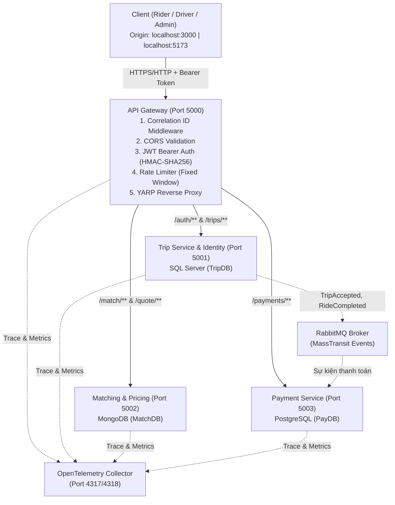

# Luồng Xử Lý Request và Tích Hợp Microservices (API Flow)

Tài liệu này hướng dẫn các nhà phát triển triển khai dịch vụ (TripService, MatchingService, PaymentService) và tích hợp hệ thống trong dự án SwiftRide.

---

## 1. Kiến Trúc Tổng Thể & Luồng Request

Toàn bộ request từ client (Rider App / Driver App / Admin Dashboard) bắt buộc phải đi qua **API Gateway (YARP)** trước khi được chuyển tiếp đến các service nội bộ:



---

## 2. Các Tầng Xử Lý Tại API Gateway

Mỗi request khi đến Gateway (port `5000`) sẽ đi qua pipeline middleware theo thứ tự:

1. **Correlation ID (`UseSwiftRideCorrelationId`)**:
   - Trích xuất TraceId từ `Activity.Current` (do OpenTelemetry tạo).
   - Tự động gắn header `X-Correlation-ID: <trace_id>` vào mọi response (kể cả response trả về lỗi 401, 403, 429).
2. **CORS (`UseCors`)**:
   - Cho phép các origin cấu hình trong `Cors:AllowedOrigins` (mặc định: `http://localhost:3000`, `http://localhost:5173`).
   - Xử lý các request preflight `OPTIONS` ngay tại Gateway, trả về `204 No Content` cùng các header CORS cần thiết mà không kích hoạt xác thực hay rate limit.
3. **Authentication (`UseAuthentication`)**:
   - Xác thực JWT access token được ký bởi `TripService` (khóa đối xứng `SymmetricSecurityKey` HMAC-SHA256).
   - Kiểm tra chữ ký số, audience (`swiftride-api`), thời hạn (`exp`), issuer (`SwiftRide`).
   - Các route công khai như `/auth/login`, `/auth/register`, `/health/live` cho phép gọi ẩn danh.
4. **Authorization (`UseAuthorization`)**:
   - Áp dụng fallback policy: các route nghiệp vụ yêu cầu user đã đăng nhập.
5. **Rate Limiting (`UseRateLimiter`)**:
   - Kiểm soát tần suất gọi API, nếu vượt ngưỡng trả về `429 Too Many Requests`.
6. **YARP Routing**:
   - Chuyển tiếp request đến downstream cluster tương ứng mà không làm thay đổi đường dẫn URL.
   - Tự động truyền header `traceparent` (W3C standard) và `Authorization` sang service đích.

---

## 3. Bản Đồ Định Tuyến (Routing Table) & Rate Limit

### Bảng chuyển tiếp URL

| Route Key | Đường dẫn khớp (Path Match) | Đích (Cluster) | Port nội bộ / Docker | Chính sách Auth | Chính sách Rate Limit |
| :--- | :--- | :--- | :--- | :--- | :--- |
| `auth` | `/auth/{**catch-all}` | `trip` | `5001` (`trip-service:8080`) | Công khai / Auth cục bộ | `Global Limiter` |
| `admin-login` | `/admin/auth/{**catch-all}` | `trip` | `5001` (`trip-service:8080`) | Công khai / Auth cục bộ | `admin-login-rate` |
| `admin-trips` | `/admin/trips/{**catch-all}` | `trip` | `5001` (`trip-service:8080`) | `Admin` | `admin-dashboard-rate` |
| `admin-users` | `/admin/users/{**catch-all}` | `trip` | `5001` (`trip-service:8080`) | `Admin` | `admin-dashboard-rate` |
| `admin-payments` | `/admin/payments/{**catch-all}` | `payment` | `5003` (`payment-service:8080`) | `Admin` | `admin-dashboard-rate` |
| `trips` | `/trips/{**catch-all}` | `trip` | `5001` (`trip-service:8080`) | `Authenticated` | `rider-booking` |
| `matching` | `/match/{**catch-all}` | `matching` | `5002` (`matching-service:8080`) | `Authenticated` | `rider-booking` |
| `quotes` | `/quote/{**catch-all}` | `matching` | `5002` (`matching-service:8080`) | `Authenticated` | `rider-booking` |
| `payments` | `/payments/{**catch-all}` | `payment` | `5003` (`payment-service:8080`) | `Authenticated` | `payment` |

*Ghi chú: Route `/health/live` trên Gateway cho phép gọi ẩn danh (`AllowAnonymous`).*

### Quy tắc Rate Limit

- **`rider-booking`**: Tối đa **10 requests / 10 giây**. Phân vùng theo `sub` (User ID trong token), nếu chưa đăng nhập fallback theo IP client. Hàng đợi (Queue) = 0.
- **`payment`**: Tối đa **5 requests / 60 giây**. Phân vùng theo `sub` (User ID trong token). Hàng đợi = 0.
- **`admin-login-rate`**: Tối đa **5 requests / 60 giây** trên mỗi IP kết nối. Chống brute-force mật khẩu quản trị.
- **`admin-dashboard-rate`**: Tối đa **100 requests / 10 giây** phân vùng theo `sub` của Admin. Hàng đợi = 10. Phục vụ dashboard tải báo cáo và biểu đồ.
- **Global Limiter**: Tối đa **30 requests / 10 giây** trên mỗi IP kết nối. Hàng đợi = 2.

---

## 4. Hướng Dẫn Dành Cho Nhà Phát Triển Service (Backend)

### 4.1. Khởi tạo Service với Shared Security & Telemetry

Mọi service trong solution tham chiếu project `SwiftRide.Security` và cấu hình trong `Program.cs`:

```csharp
using SwiftRide.Security;

var builder = WebApplication.CreateBuilder(args);

// 1. Đăng ký Telemetry (OTel exporter & metrics)
builder.Services.AddSwiftRideTelemetry("SwiftRide.TripService");

// 2. Đăng ký JWT Authentication & Dynamic RBAC Authorization
builder.Services.AddSwiftRideAuthentication(builder.Configuration);

var app = builder.Build();

// 3. Pipeline middleware: Thứ tự bắt buộc
app.UseHttpsRedirection();
app.UseSwiftRideCorrelationId(); // Bắt buộc đặt TRƯỚC UseAuthentication
app.UseAuthentication();
app.UseAuthorization();

// 4. Endpoint kiểm tra sức khỏe
app.MapGet("/health/live", () => Results.Ok(new { status = "Healthy" }))
   .AllowAnonymous();

app.Run();
```

### 4.2. Bảo vệ Endpoint theo Phân Quyền Động (Dynamic Permission)

Thư viện `SwiftRide.Security` cung cấp phương thức mở rộng `.RequirePermission(...)`:

```csharp
// Bảo vệ theo mã quyền cụ thể
app.MapPost("/trips", CreateTripHandler)
   .RequirePermission(PermissionsCatalog.TripsCreate);

app.MapPost("/trips/{id:guid}/driver-accept", DriverAcceptHandler)
   .RequirePermission(PermissionsCatalog.TripsAccept);
```

**Nguyên tắc đánh giá quyền**:
1. User có role `Admin`: Tự động được cấp quyền cho **tất cả** endpoint.
2. User thông thường: Phải có claim `permission: <code_quyền>` trong JWT Access Token.
3. Nếu không đủ quyền: Trả về `403 Forbidden`.

### 4.3. Kiểm tra quyền sở hữu tài nguyên (Resource-Based Authorization)

> **CẢNH BÁO QUAN TRỌNG:** Phân quyền theo permission chỉ kiểm tra user *có quyền thực hiện hành động đó hay không*. Service **bắt buộc** phải tự kiểm tra quyền sở hữu đối với tài nguyên cụ thể:
> - Rider A **không được phép** xem thông tin chi tiết hoặc hủy chuyến xe thuộc về Rider B.
> - Luôn so sánh `user.FindFirst("sub")?.Value` với trường `RiderId` hoặc `DriverId` được lưu trong Database trước khi thực hiện logic.

### 4.4. Trích xuất thông tin User từ HttpContext / ClaimsPrincipal

| Thông tin | Claim Type | Ví dụ code C# |
| :--- | :--- | :--- |
| User ID | `"sub"` hoặc `ClaimTypes.NameIdentifier` | `user.FindFirst("sub")?.Value` |
| Tên đăng nhập | `"name"` hoặc `ClaimTypes.Name` | `user.FindFirst("name")?.Value` |
| Email | `"email"` | `user.FindFirst("email")?.Value` |
| Kiểm tra Role | `"role"` | `user.IsInRole("Rider")` |
| Danh sách quyền | `"permission"` | `user.FindAll("permission").Select(c => c.Value)` |

---

## 5. Quy Chuẩn Xử Lý Lỗi (Error Response Conventions)

Toàn bộ API trả về lỗi theo chuẩn **RFC 7807 (Problem Details)**:

- `400 Bad Request`: Dữ liệu đầu vào sai định dạng, thiếu trường bắt buộc.
- `401 Unauthorized`: Không truyền token, token sai chữ ký hoặc đã hết hạn.
- `403 Forbidden`: User thiếu quyền (permission) cần thiết hoặc không có quyền truy cập tài nguyên.
- `404 Not Found`: Không tìm thấy bản ghi (chuyến đi, giao dịch thanh toán...).
- `409 Conflict`: Vi phạm trạng thái nghiệp vụ (ví dụ: nhận chuyến đã bị hủy).
- `429 Too Many Requests`: Gửi request quá nhanh vượt mức Rate Limiter cho phép.
- `501 Not Implemented`: Chức năng đang trong giai đoạn phát triển scaffold.
