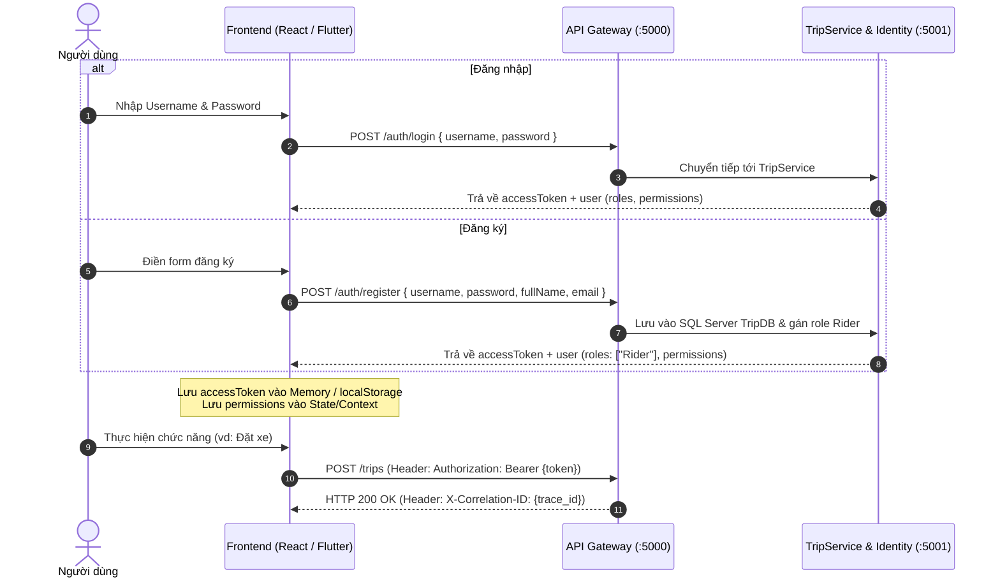

# Hướng Dẫn Tích Hợp Đăng Nhập & Đăng Ký Cho Frontend (Frontend Auth Guide)

Tài liệu này dành cho các nhà phát triển Frontend (React, Vue, Vite, Next.js, Flutter...) xây dựng ứng dụng Rider Web/Mobile và Driver Mobile trong hệ thống SwiftRide.

---

## 1. Nguyên Tắc & Luồng Gọi REST API Trực Tiếp

Hệ thống SwiftRide sử dụng luồng xác thực REST API chuẩn với JWT Bearer Token trực tiếp qua **API Gateway (Port 5000)**:
- Ứng dụng Frontend tự thiết kế giao diện form Đăng nhập (Login) và Đăng ký (Register).
- Dữ liệu gửi trực tiếp qua Gateway tới endpoint `/auth/login` và `/auth/register`.
- Khi thành công, Frontend nhận về `accessToken` và đối tượng `user` chứa danh sách `roles` và `permissions`.
- Các request tiếp theo chỉ cần đính kèm header: `Authorization: Bearer <accessToken>`.

---

## 2. Thông Số Cấu Hình Frontend

| Tham số | Giá trị trong môi trường Dev | Ý nghĩa |
| :--- | :--- | :--- |
| **API Gateway URL** | `http://localhost:5000` | Điểm vào duy nhất cho toàn bộ API |
| **Login Endpoint** | `POST http://localhost:5000/auth/login` | Đăng nhập tài khoản |
| **Register Endpoint** | `POST http://localhost:5000/auth/register` | Đăng ký tài khoản người dùng mới |
| **Me Endpoint** | `GET http://localhost:5000/auth/me` | Lấy profile và quyền của user đang đăng nhập |
| **Token Type** | `Bearer` | Loại token truyền trong header `Authorization` |
| **CORS Origins** | `http://localhost:3000`, `http://localhost:5173` | Các origin được Gateway chấp thuận |

---

## 3. Sơ Đồ Luồng Xác Thực



---

## 4. Chi Tiết Thực Hiện Từng Chức Năng

### 4.1. Chức Năng Đăng Nhập (Login)

Frontend gửi request POST JSON:
```typescript
interface LoginResponse {
  accessToken: string;
  tokenType: string;
  expiresIn: number;
  user: {
    id: string;
    username: string;
    fullName: string;
    email: string;
    roles: string[];
    permissions: string[];
  };
}

async function login(username: string, password: string): Promise<LoginResponse> {
  const response = await fetch('http://localhost:5000/auth/login', {
    method: 'POST',
    headers: { 'Content-Type': 'application/json' },
    body: JSON.stringify({ username, password })
  });

  if (!response.ok) {
    const error = await response.json();
    throw new Error(error.detail || 'Đăng nhập không thành công');
  }

  return response.json();
}
```

### 4.2. Chức Năng Đăng Ký (Register)

```typescript
async function register(userData: {
  username: string;
  password: string;
  fullName: string;
  email: string;
}): Promise<LoginResponse> {
  const response = await fetch('http://localhost:5000/auth/register', {
    method: 'POST',
    headers: { 'Content-Type': 'application/json' },
    body: JSON.stringify({
      ...userData,
      role: 'Rider' // Mặc định đăng ký mới là khách đặt xe
    })
  });

  if (!response.ok) {
    const error = await response.json();
    throw new Error(error.detail || 'Đăng ký không thành công');
  }

  return response.json();
}
```

### 4.3. Quản Lý Quyền Trên Giao Diện (Dynamic RBAC UI Permission Check)

Trong ứng dụng Frontend (React/Vue/Flutter), thay vì kiểm tra role cứng, bạn có thể kiểm tra danh sách `permissions` được trả về từ token hoặc API `/auth/me` để ẩn/hiện các nút bấm:

```typescript
// Hook kiểm tra quyền trong React
export function usePermission() {
  const { user } = useAuth(); // Lấy user từ AuthContext

  const hasPermission = (permissionCode: string): boolean => {
    if (!user) return false;
    // Admin có toàn quyền
    if (user.roles.includes('Admin')) return true;
    return user.permissions.includes(permissionCode);
  };

  return { hasPermission };
}

// Ví dụ sử dụng trong Component đặt chuyến:
function BookingView() {
  const { hasPermission } = usePermission();

  return (
    <div>
      {hasPermission('trips.create') && (
        <button onClick={handleBookRide}>Đặt chuyến đi</button>
      )}

      {hasPermission('matching.quote') && (
        <button onClick={handleGetQuote}>Xem giá ước tính</button>
      )}
    </div>
  );
}
```

### 4.4. Gọi API Nghiệp Vụ Với Token

Mọi request gọi tới Gateway cần đính kèm header `Authorization`:

```typescript
async function bookTrip(pickup: string, dropoff: string, token: string) {
  const response = await fetch('http://localhost:5000/trips', {
    method: 'POST',
    headers: {
      'Content-Type': 'application/json',
      'Authorization': `Bearer ${token}`
    },
    body: JSON.stringify({ pickup, dropoff })
  });

  const correlationId = response.headers.get('X-Correlation-ID');
  console.log('Trace Correlation ID:', correlationId);

  return response.json();
}
```

---

## 5. Tài Khoản Kiểm Thử Sẵn Có

Để phát triển và kiểm thử giao diện Frontend mà không cần đăng ký mới:
- **Khách đặt xe (Rider)**: `test-rider` / `Rider@123`
- **Tài xế (Driver)**: `test-driver` / `Driver@123`
- **Quản trị viên (Admin)**: `admin` / `Admin@123`
