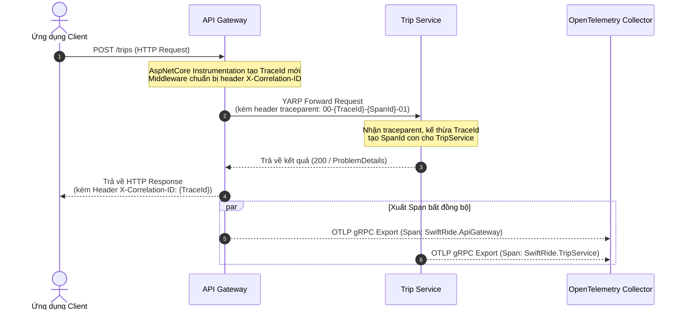

# Hướng Dẫn Giám Sát Phân Tán Với OpenTelemetry (Telemetry Guide)

Tài liệu này hướng dẫn cách thức hoạt động của hệ thống quan sát phân tán (Distributed Tracing & Metrics), cách tích hợp vào từng microservice qua thư viện `SwiftRide.Security`, và cách truy vết sự cố theo Correlation ID.

---

## 1. Cơ Chế Hoạt Động & Luồng Truy Vết (Distributed Tracing)

Trong kiến trúc microservices của SwiftRide, một hành động của người dùng (ví dụ: đặt chuyến) sẽ đi qua API Gateway, tiếp cận TripService, phát sự kiện sang RabbitMQ và xử lý tại PaymentService. Để kết nối toàn bộ chuỗi sự kiện này vào một đồ thị thống nhất, hệ thống sử dụng **W3C Trace Context Standard** và **OpenTelemetry (OTel)**.



---

## 2. Header `X-Correlation-ID` & Middleware

Khi có lỗi xảy ra ở môi trường production hoặc kiểm thử, Client chỉ cần cung cấp mã `X-Correlation-ID` lấy từ Response Header để đội ngũ Backend có thể tra cứu toàn bộ log và vết gọi qua tất cả các service liên quan.

### 2.1. Đảm Bảo Bắt Được Cả Lỗi Sớm (401, 403, 429)
Nhiều middleware trong ASP.NET Core ngắt pipeline sớm khi xác thực hoặc phân quyền thất bại (ví dụ: trả về `401 Unauthorized` ngay lập tức). Nếu middleware gắn header được đặt sau hoặc không dùng cơ chế thích hợp, response sẽ bị thiếu header này.

Trong `SwiftRide.Security/TelemetryExtensions.cs`:
```csharp
public static IApplicationBuilder UseSwiftRideCorrelationId(this IApplicationBuilder app)
{
    return app.Use(async (ctx, next) =>
    {
        ctx.Response.OnStarting(() =>
        {
            var traceId = Activity.Current?.TraceId.ToString();
            if (!string.IsNullOrEmpty(traceId))
                ctx.Response.Headers["X-Correlation-ID"] = traceId;

            return Task.CompletedTask;
        });

        await next();
    });
}
```
*Lưu ý*: `ctx.Response.OnStarting` đảm bảo callback được kích hoạt ngay trước khi các byte đầu tiên của HTTP response header được gửi đi, giúp `X-Correlation-ID` luôn hiện diện trên mọi phản hồi.

---

## 3. Cách Tích Hợp Vào Service Mới

Khi tạo một microservice mới trong giải pháp SwiftRide:

### 3.1. Cài đặt NuGet Package
Thêm các package sau vào file `.csproj` (hoặc kế thừa từ thư viện `SwiftRide.Security`):
- `OpenTelemetry.Exporter.OpenTelemetryProtocol` (v1.19.1+)
- `OpenTelemetry.Extensions.Hosting` (v1.19.1+)
- `OpenTelemetry.Instrumentation.AspNetCore` (v1.19.0+)
- `OpenTelemetry.Instrumentation.Http` (v1.19.0+)

### 3.2. Đăng ký trong `Program.cs`
```csharp
using SwiftRide.Security;

var builder = WebApplication.CreateBuilder(args);

// 1. Đăng ký Telemetry với tên định danh của service
builder.Services.AddSwiftRideTelemetry("SwiftRide.PaymentService");

var app = builder.Build();

// 2. Middleware pipeline: Luôn đặt trước UseAuthentication & UseAuthorization
app.UseHttpsRedirection();
app.UseSwiftRideCorrelationId();
app.UseAuthentication();
app.UseAuthorization();

// ... Các route của service
app.Run();
```

Thư viện tự động:
- Lọc bỏ các request kiểm tra sức khỏe `/health/*` để tránh gây nhiễu dữ liệu trace.
- Tự động ghi lại exception unhandled (`RecordException = true`).
- Theo dõi các HTTP call ra ngoài (`HttpClientInstrumentation`) và tự động chèn header `traceparent` cho các lời gọi liên service.

---

## 4. Cấu Hình Hạ Tầng OTLP Collector

### 4.1. Biến Môi Trường (Environment Variables)
Các service tìm kiếm OTLP endpoint thông qua biến môi trường tiêu chuẩn của OpenTelemetry:

| Biến môi trường | Giá trị trong Docker Compose | Giá trị khi chạy Local trên Host |
| :--- | :--- | :--- |
| `OTEL_EXPORTER_OTLP_ENDPOINT` | `http://otel-collector:4317` | `http://localhost:4317` |
| `OTEL_EXPORTER_OTLP_PROTOCOL` | `grpc` | `grpc` |

### 4.2. Cấu Hình Exporter (`.devcontainer/otel-collector.yaml`)
Collector trong môi trường phát triển đang sử dụng exporter `debug` để in thông tin ra log:

```yaml
receivers:
  otlp:
    protocols:
      grpc:
        endpoint: 0.0.0.0:4317
      http:
        endpoint: 0.0.0.0:4318

exporters:
  debug:
    verbosity: basic # Đổi thành 'detailed' để in chi tiết từng Span và Attributes

service:
  pipelines:
    traces:
      receivers: [otlp]
      exporters: [debug]
    metrics:
      receivers: [otlp]
      exporters: [debug]
```

### 4.3. Cách Xem Log Trace
Xem log xuất ra từ OTel Collector bằng lệnh Docker Compose:
```bash
docker compose -f .devcontainer/compose.yaml logs -f otel-collector
```

Nếu muốn in chi tiết toàn bộ thuộc tính của span, sửa trường `verbosity: basic` thành `verbosity: detailed` trong file `.devcontainer/otel-collector.yaml`, sau đó khởi động lại container:
```bash
docker compose -f .devcontainer/compose.yaml restart otel-collector
```

---

## 5. Quy Chuẩn An Toàn & Bảo Mật Dữ Liệu
1. **Không log Token / Bí mật**: Tuyệt đối không gắn Authorization Header, Cookie session, hoặc JWT Bearer Token vào các thuộc tính (Tag/Attribute) của OpenTelemetry Span.
2. **Không log Dữ liệu Nhạy cảm (PII / PCI)**: Tuyệt đối không đưa số thẻ tín dụng, mã CVV, số căn cước hay mật khẩu vào trace attributes hoặc exception log.
